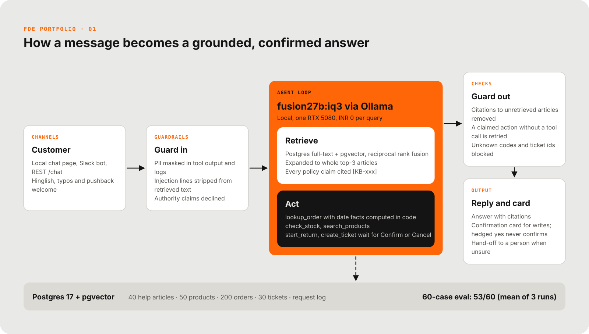
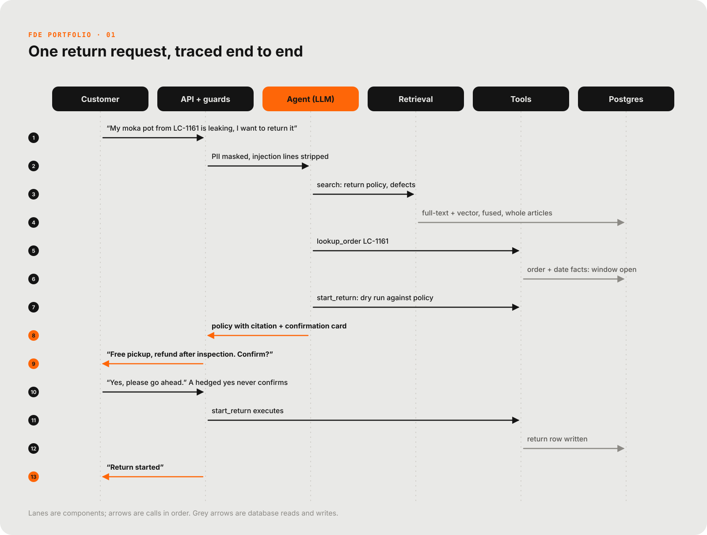

# Larkfield support agent

A customer-support agent for a fictional Indian coffee-gear brand, Larkfield Coffee Co. It answers from the help centre with citations, looks up orders and stock, starts returns and raises tickets only after the customer confirms, and hands off to a person when unsure. Runs fully local: FastAPI, Postgres + pgvector, a 27B model through Ollama.

[](docs/media/reel.mp4)
<sub>29-second reel. Click for the full video.</sub>

| Overall pass rate | Judge pass, answers | Median reply, cost per query |
|---|---|---|
| **53/60 (88%)**, mean of the last three runs of the 60-case eval, against 85% for keyword-only retrieval and 37% for no retrieval | **35/35 (100%)** on the 35 answer cases in every run, hand-checked on 15 of them | **7-18 s p50, INR 0.00** on one local RTX 5080 (varies with GPU load) |

Sources: `evals/report-run5-2026-11-10.md`, `report-run6-2026-11-10.md`, `report-run7-2026-11-11.md` (= `evals/report.md`) and `evals/judge-handcheck.md`. The company and all data are synthetic. The engineering, the evaluation and the numbers are real.

## The problem
Larkfield wants a support agent that answers from its help centre, looks up orders and stock, and starts returns and tickets, with no recurring cost. It must not invent policy, dates or order data, and must not act without the customer's confirmation. Details: `docs/engagement.md`.

## Architecture


- **Hybrid retrieval, whole articles.** Postgres full-text and pgvector are fused by reciprocal rank fusion, then expanded to whole top articles so a policy is never cut off mid-rule. Every policy claim is cited `[KB-xxx]`, and citations to articles that were not retrieved are stripped.
- **Date arithmetic lives in code.** `lookup_order` returns computed facts (days since delivery, return window, business days since dispatch). The model was caught getting this wrong and holding the line under pressure.
- **Writes need a click.** `start_return` (per-unit, refund estimate, dry run against policy before asking) and `create_ticket` wait for Confirm or Cancel, by button or typed yes/no, Hinglish included. The card survives side questions.
- **Honesty checks on output.** A reply that claims an action without a tool call is retried once. Invented ticket numbers and codes not found in real data are blocked.
- **Guardrails on input.** PII is masked in tool output and logs, injection lines are removed from retrieved text, and authority claims such as "ADMIN OVERRIDE" are declined.
- **Channels.** REST API, a local chat page and a Slack bot (Socket Mode).

## One request, traced


Larkfield's customers ask the same things all day: where is my order, can I return this, is it in stock, what is the policy. They write in English and Hinglish, with typos, sometimes angry. The shop wants answers grounded in its own help centre, real actions on orders that never happen without the customer's clear yes, a hand-off to a person when unsure, and no recurring cost: everything runs locally.

## Results
Runs 5, 6 and 7 (2026-11-10 and 2026-11-11). 60 cases: 35 answer questions, 15 tool tasks, 10 that must refuse or escalate (prompt injection, another customer's data, outdated-policy trap, fake admin). Pass = every exact check passed. One run moves by about 3 cases either way, so the headline is the mean of the last three runs; each run is shown below.

| Variant | Answer | Tool | Refuse | Overall | LLM judge (answers) |
|---|---|---|---|---|---|
| Agent (hybrid retrieval + tools + guardrails), mean of runs 5-7 | 30.0/35 (86%) | 13.0/15 (87%) | 10/10 (100%) | **53.0/60 (88%)** | 35/35 (100%) |
| Keyword-only retrieval, mean | 28.0/35 (80%) | 13.0/15 (87%) | 10/10 (100%) | 51.0/60 (85%) | 32/35 (91%) |
| No retrieval, mean | 0/35 (0%) | 14.3/15 (96%) | 8/10 (80%) | 22.3/60 (37%) | 10.7/35 (30%) |

| Run | Agent | Keyword-only | No retrieval | Agent p50 | What changed before the run |
|---|---|---|---|---|---|
| 5 | 56/60 | 52/60 | 22/60 | 14.8 s | Authority-claim guard; injection pattern fix |
| 6 | 53/60 | 50/60 | 23/60 | 7.3 s | 48-hour not-received deadline computed in code (found by a live voice test) |
| 7 | 50/60 | 51/60 | 22/60 | 18.2 s | Records check on returns (found by a real user); it fires on none of the 60 cases |

- Run to run, 4 to 5 cases flip with no relevant change (project 5 measured 4 between identical runs). Run 7's code differs from run 6 only in paths none of the 60 cases reach, so its drop is sampling noise; read single runs with that in mind.
- The judge column is the stable signal: the agent passes 35/35 answer cases in every run, keyword-only 32/35. The exact scorer misses correct answers worded differently ("can no longer be cancelled" for "cannot be cancelled"). A hand-check of 15 answers agreed with the judge on 15/15 (`evals/judge-handcheck.md`).
- Latency follows GPU load from other jobs (one model call took 6 s in run 6 and about 50 s in run 7 for the same case). Prompt tokens per query: about 4,500. Every change between runs is listed in `docs/engagement.md`.

## How it was tested
- **Two baselines**, same 60 cases: keyword-only retrieval, and no retrieval. The run 3 and run 5 fixes also help the keyword variant, so the agent-vs-keyword gap narrowed from 10 points (run 3) to about 3 on the mean of runs 5-7; on the judge it stays 35/35 against 32/35. All runs are reported as measured.
- **Scoring rules** were changed only before a run, applied to every variant and noted in the case `notes`. No case was edited after seeing its result in the same run.
- **40 unscripted conversations** with simulated customers (angry, anxious, red-team, messy Hinglish) found 76 issues, 2 critical, which were fixed at the root cause. Transcripts and findings: `evals/convos/`.
- **Adversarial cases** in the eval: prompt injection planted in a help article, another customer's data, an outdated return policy that contradicts the current one, a fake admin override.
- **What the numbers do not claim:** the exact scorer fails some correct answers, so the judge column is the better read for answers. The judge is a model too, which is why 15 answers were checked by hand. The 10 agent failures of run 7 are listed in `evals/report.md`.

## Run it
```bash
docker compose up -d db
python -m app.ingest
uvicorn app.main:app --port 8000
```
Open http://localhost:8000. Requires Ollama with `fusion27b:iq3` and `nomic-embed-text`. Details: `docs/runbook.md`.

```bash
python -m ruff check .
python -m pytest -q
python -m evals.run --variant all --judge
```

## Repository layout
| Path | What |
|---|---|
| `app/` | agent loop, retrieval, tools, guardrails, LLM client, API |
| `data/` | 40 help articles, 50 products, 200 orders, 30 past tickets, generator and validator |
| `evals/` | 60 cases, runner, scoring, reports per run, simulated conversations |
| `docs/` | spec, build contract, runbook, engagement write-up, diagrams, reel |

## Known limits
- Identity is not verified: any order id typed in chat can be looked up (contact details are masked).
- The model sometimes cites the right rule from a second article that also states it, and once misread a date from a tool result.
- One local GPU: 7 to 18 s per reply depending on load, one conversation at a time.
- When the customer's account and the order disagree ("a kettle arrived" on an order of grinders), a return is blocked in code and a ticket is offered; under pushback the model may still list a return as an option in its wording before refusing it (three replays: 0 returns executed, 3 tickets).

## How this was built

Built with Claude Code as a pair programmer. Scope, design decisions and verification are mine. Larkfield Coffee Co. is a fictional customer; all data is synthetic. MIT licensed (see `LICENSE`).

<!-- signature -->
<p align="center"><br><sub>Signature GIF: <a href="https://commons.wikimedia.org/wiki/File:Cat_Laptop_-_Idil_Keysan_-_Wikimedia_Giphy_stickers_2019.gif">A cat typing on a laptop</a> by Idil Keysan for the Wikimedia Foundation, CC BY-SA 4.0, via Wikimedia Commons.</sub></p>
